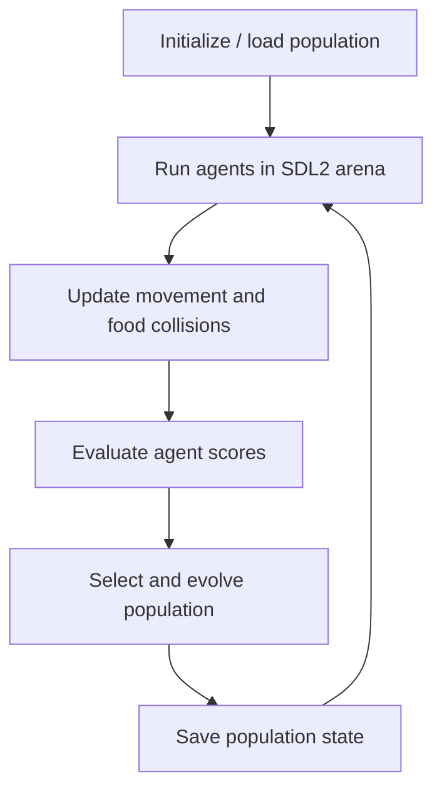

<div align="center">

# Evolutionary Snake

**A C++ / SDL2 simulation where neural-network-controlled snakes evolve through a genetic algorithm.**


</div>

## Contents

- [Overview](#overview)
- [Evolution loop](#evolution-loop)
- [Simulation configuration](#simulation-configuration)
- [Controls](#controls)
- [Requirements](#requirements)
- [Build and run](#build-and-run)
- [Saving and experiment state](#saving-and-experiment-state)
- [Repository structure](#repository-structure)
- [Reproducibility and limitations](#reproducibility-and-limitations)
- [License](#license)

## Overview

Evolutionary Snake uses the classic Snake game as an environment for experimenting with neural networks and genetic algorithms. A population of agents moves through a rendered SDL2 arena, collects food, and is evaluated over successive generations.

The implementation includes custom matrix and neural-network code, Snake behavior, food entities, population management, and model persistence.

## Evolution loop



This diagram summarizes the evolutionary structure visible in the source; exact fitness and selection details are implemented in the C++ files.

## Simulation configuration

Values currently defined in `main.cpp` include:

| Setting | Value |
|---|---:|
| Initial population size | 400 |
| Maximum generation index | 2,000 |
| Mutation rate | 0.08 (8%) |
| Initial window size | 600 × 600 |
| Fullscreen dimensions | 2,560 × 1,600 |
| Default simulation FPS | 1,000 |

These are source defaults, not performance guarantees. The actual display dimensions depend on the host system.

## Controls

The current input handler defines:

| Key | Action |
|---|---|
| `1` | Set simulation FPS to 60 |
| `2` | Set simulation FPS to 1,000 |
| `Esc` | Exit the simulation |

## Requirements

- C++17-compatible compiler (the source uses `std::filesystem`)
- SDL2
- SDL2_image
- Linux environment compatible with the included shell script

## Build and run

### Build

The included `comp.sh` compiles the application from the main source and the files under `include/`:

```bash
g++ -std=c++17 -o model main.cpp include/matriz_lib.cpp include/rede_neural_lib.cpp include/snake.cpp include/plantas.cpp -m64 -g -Iinclude -Llib -Wall -lSDL2main -lSDL2 -lSDL2_image
```

### Run

```bash
./model
```

The script currently leaves the execution command commented out, so run the generated binary manually after a successful build.

## Saving and experiment state

The program checks the `saves/` directory to decide whether to load an existing population. **Important:** the supplied `comp.sh` removes `saves/*.txt` before compiling when the directory contains files. Back up saved models before running that script.

## Repository structure

```text
Snake/
├── include/
│   ├── matriz_lib.*
│   ├── rede_neural_lib.*
│   ├── snake.*
│   └── plantas.*
├── main.cpp
├── model
├── comp.sh
└── saves/
```

## Reproducibility and limitations

For comparable experiments, record the random seed, population size, mutation rate, fitness function, selection method, maximum steps, and saved model version. The values above describe the current source configuration and are not a benchmark.

The repository includes SDL2 shared-library files; compatibility with other operating systems and architectures is not guaranteed.

## License

No `LICENSE` file is currently included. Unless a license is added, reuse and redistribution permissions are not granted by this repository.
